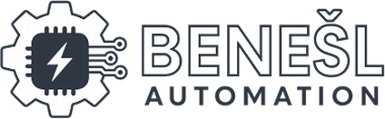

# BAVIS SDK

**Write communication drivers for BAVIS – the web SCADA you configure yourself – without access to its core.**

[Česky níže](#česky)

BAVIS is a web-based SCADA / HMI platform by [Benešl Automation](https://benesl-automation.cz). Connections, tags, alarms,
screens, trends and reports are set up in tables and wizards instead of code. When a device or protocol is missing, you can add it
yourself: a driver is a small Python package, built into a `.bavispkg` file and installed in **System → Projects and packages** –
no new BAVIS release is needed.

* **SDK API 1.0** (`bavis.sdk`) – drivers are loaded by BAVIS **3.1 and newer**, also after the next major version of the core.
* **`bavis sdk` command** (skeleton, check, tests, build) – in every installation of BAVIS **4.0 and newer** (Windows, Linux,
  Docker). No core source code and no separate Python installation needed.

## Quick start

```
bavis-sdk new my_scale --label "Moje váha" --dir ~/drivers/scale    # driver, fake device, tests, translations
bavis-sdk test ~/drivers/scale                                       # pytest against the installed core
bavis-sdk check --strict ~/drivers/scale                             # what the build or the core would refuse
bavis-sdk build ~/drivers/scale                                      # dist/drv_my_scale-1.0.0.bavispkg
```

Windows: `C:\BAVIS\bavis-sdk.cmd …` · Linux: `/opt/bavis/bavis-sdk …` · Docker: `docker run --rm -v "$PWD:/work" -w /work --user "$(id -u):$(id -g)" <image> sdk …`

## What is here

| Folder | Content |
| --- | --- |
| [docs/en](docs/en/README.md) | guides: getting started, your first driver, patterns, testing, building and installing, CI and publishing |
| [docs/cs](docs/cs/README.md) | the same guides in Czech |
| [docs/drivers.md](docs/drivers.md) | API reference (`bavis.sdk`, `bavis.sdk.testing`, package layout, versioning, rules) |
| [examples](examples/README.md) | nine complete drivers with tests: from *hello* to Modbus ASCII, Prometheus, NTP and P1 smart meters |
| [drivers](drivers/README.md) | community drivers contributed to the public catalogue |
| [action.yml](action.yml) | GitHub Action: check, test and build driver packages with the BAVIS Docker image |

## Examples

| Example | Shows |
| --- | --- |
| [http_json](examples/http_json) | one HTTP request per cycle, address = path in a JSON document, custom field, connection test |
| [scpi](examples/scpi) | text protocol over TCP (lab instruments), a link shared by reads and writes, guarded writes checked with `SYST:ERR?` |
| [udp_json](examples/udp_json) | a device that pushes data, only `open` / `close` / `poll`, value age, sender filter |
| [csv_file](examples/csv_file) | no network (`transport="none"`), files in the data folder, tag import by browsing, caching |
| [hello](examples/hello) | **start here** – the smallest complete driver, no device needed |
| [modbus_ascii](examples/modbus_ascii) | serial line (RS-232 / RS-485 or a `socket://` converter), block reads, checksum, guarded writes |
| [prometheus](examples/prometheus) | text format over HTTP(S), secret token, tag import by browsing |
| [ntp](examples/ntp) | binary protocol over UDP, answer validation, query interval independent of the read cycle |
| [dsmr_p1](examples/dsmr_p1) | a meter pushing telegrams on a serial line, frames, CRC-16, value age |

Every example passes `bavis-sdk check --strict` and its own tests.

## What the SDK does not cover yet

SDK 1.0 is for communication drivers. Symbols, device types, screens and report templates are shared as catalogue *parts*
exported from a project, without programming. Servers (BAVIS publishing data elsewhere) and custom screen elements are not
part of the SDK yet.

## Contributing

Community drivers are welcome – read [CONTRIBUTING.md](CONTRIBUTING.md). Drivers accepted into the public catalogue are reviewed
and signed by Benešl Automation.

* Questions and help: [Discussions → Q&A](https://github.com/Tomoash/BAVIS-SDK/discussions/categories/q-a)
* Wishes for devices and protocols (vote with 👍): [Discussions → Drivers](https://github.com/Tomoash/BAVIS-SDK/discussions/categories/drivers)
* Show what you built: [Discussions → Show and tell](https://github.com/Tomoash/BAVIS-SDK/discussions/categories/show-and-tell)
* Small tasks to start with: [`good first issue`](https://github.com/Tomoash/BAVIS-SDK/labels/good%20first%20issue)

## Licence

The SDK documentation, examples and tools are licensed under the [Apache License 2.0](LICENSE). The BAVIS core application is
proprietary and is not part of this repository. Siemens, SIMATIC and S7 are trademarks of Siemens AG; other product names are
trademarks of their owners and are used only to describe compatibility.

## Contact

- Website: [benesl-automation.cz](https://benesl-automation.cz)
- E-mail: [benesl@benesl-automation.cz](mailto:benesl@benesl-automation.cz)
- Security issues: see [SECURITY.md](SECURITY.md)

---

## Česky

**BAVIS SDK** slouží k psaní komunikačních driverů pro BAVIS, webovou SCADA, kterou si nastavíte sami – bez přístupu k jádru.
Driver je malý balíček v Pythonu, který se sestaví do souboru `.bavispkg` a nainstaluje v **Systém → Projekty a balíčky**,
bez nové verze BAVIS.

* **SDK API 1.0** (`bavis.sdk`) – drivery načítá BAVIS **3.1 a novější**, i po další hlavní verzi jádra.
* **Příkaz `bavis sdk`** (kostra, kontrola, testy, sestavení) je v každé instalaci BAVIS **4.0 a novější** (Windows, Linux,
  Docker). Zdrojový kód jádra ani samostatný Python nepotřebujete.

```
bavis-sdk new moje_vaha --label "Moje váha" --dir C:\vyvoj\vaha
bavis-sdk test C:\vyvoj\vaha
bavis-sdk check --strict C:\vyvoj\vaha
bavis-sdk build C:\vyvoj\vaha
```

Návody česky jsou v [docs/cs](docs/cs/README.md): začínáme, první driver krok za krokem, vzory driverů, testování, sestavení
a instalace, CI a zveřejnění. Reference API (anglicky) je [docs/drivers.md](docs/drivers.md), hotové příklady s testy
v [examples](examples/README.md).

Příspěvky komunity jsou vítané, postup je v [CONTRIBUTING.cs.md](CONTRIBUTING.cs.md). Dotazy patří do
[Discussions → Q&A](https://github.com/Tomoash/BAVIS-SDK/discussions/categories/q-a), přání zařízení do
[Discussions → Drivers](https://github.com/Tomoash/BAVIS-SDK/discussions/categories/drivers). Kontakt:
[benesl@benesl-automation.cz](mailto:benesl@benesl-automation.cz), web [benesl-automation.cz](https://benesl-automation.cz).
